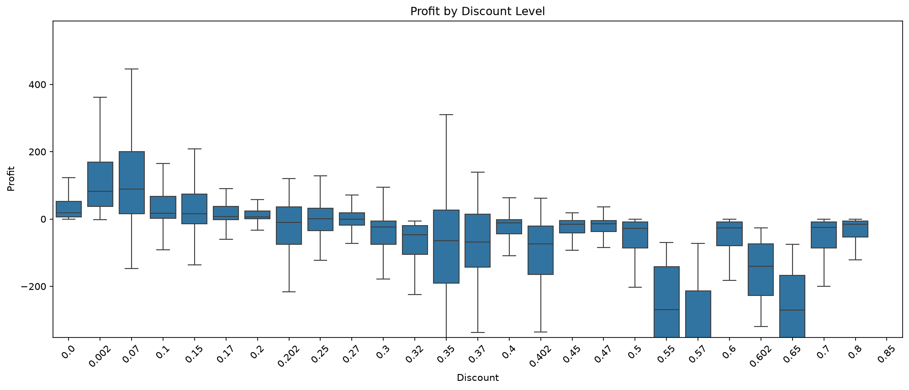
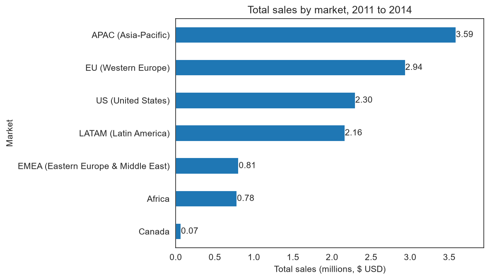
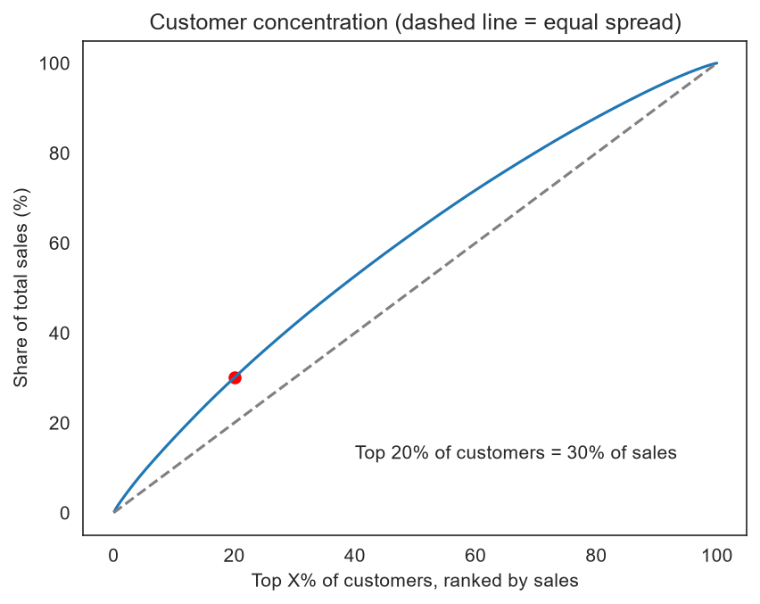
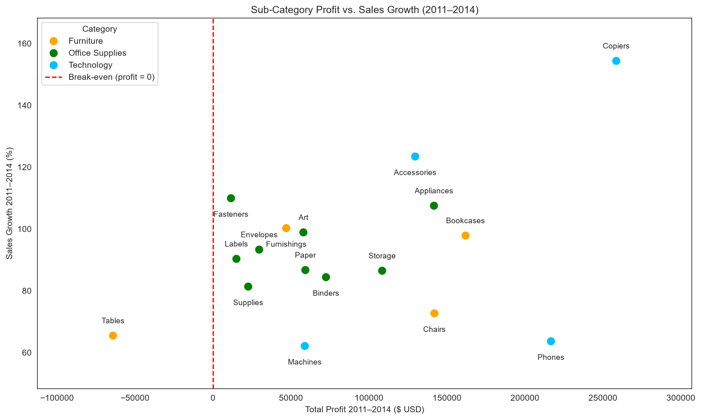
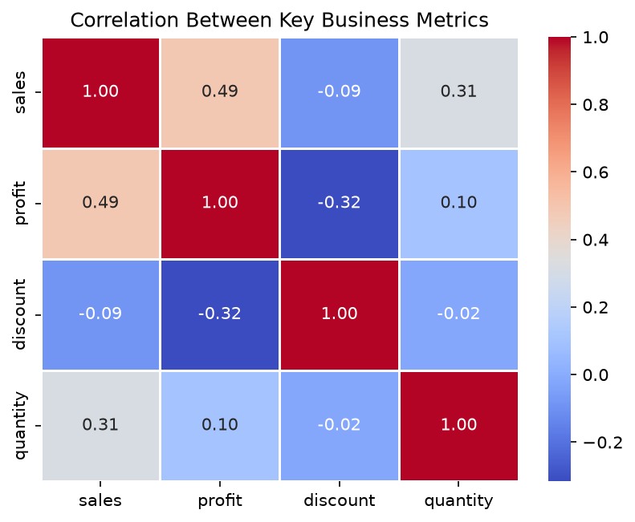

# Superstore-Sales-Analysis
Cleaned and analysed 51,290 retail order lines (2011 to 2014) with Python to find what drives sales and profit across markets, products and discount levels.
## Dataset
- Source: [SuperStore Sales Dataset on Kaggle](https://www.kaggle.com/datasets/laibaanwer/superstore-sales-dataset)
- 51,290 rows and 21 columns (25 after feature engineering), covering 2011 to 2014
-  Dataset license: [GNU LGPL 3.0](https://www.gnu.org/licenses/lgpl-3.0.html)
- Code license: MIT

## Steps
**Cleaning**
- Converted Sales from text to integer (2,630 values contained commas)
- Converted order and ship dates from two mixed formats into real dates
- Converted the year column to integer and standardised order IDs

**Validation**
- No missing values, no exact duplicates, no negative sales or quantities, discounts within 0 to 1
- No order shipped before it was ordered, and converted dates match the year column
- 38 repeated Order ID and Product ID pairs checked and kept, because quantity or shipping cost differs

**Feature engineering**
- Created delivery days, order month, order quarter and profit margin

**Analysis**
- Correlation heatmap, discount vs profit, monthly sales, profit by sub-category, sales by market

## Key findings
1. Heavy discounts lose money: no order without a discount made a loss, but 98% of orders with a 41 to 60% discount and 100% above 60% were loss-making. Average profit falls from +61 (no discount) to -112 (over 60%).
2. Tables lose money overall (total profit -64,083), while Copiers (258,568) and Phones (216,717) earn the most profit.
3. Sales are seasonal: Q4 brings 34% of sales, with December the peak (1.58M) and February the lowest (0.54M).
4. APAC, EU and US supply about 70% of total sales (28%, 23% and 18%).
5. Revenue is spread widely: the top 20% of customers (159 of 795) bring about 30% of sales.
6. 
   ## Tools
Python, Pandas, Matplotlib, Seaborn, Jupyter Notebook

 ## Charts (Ranked by Business Impact)

### 1. Profit by Discount Level
*Biggest margin leak: discounts above 40% make almost every order unprofitable.*

---

### 2. Total Sales by Month (Q4 Highlighted)
*Seasonality: Q4 drives 34% of total revenue, peaking in December ($1.58M).*

---

### 3. Total Sales by Market
*Regional share: APAC, EU, and US generate ~70% of total sales.*

---

### 4. Customer Concentration (Pareto Curve)
*Customer risk: Top 20% of customers account for ~30% of sales, showing healthy revenue spread.*

---

### 5. Sales Growth 2011 to 2014 (%) by Sub-Category
*Long-term momentum: tracks 4-year growth rates across product lines.*

---

### 6. Correlation Between Key Business Metrics
*Metric relationships: confirms the negative correlation between discount and profit.*

6. **Correlation Between Key Business Metrics**
   *Metric relationships: confirms the negative correlation between discount and profit.*
   
